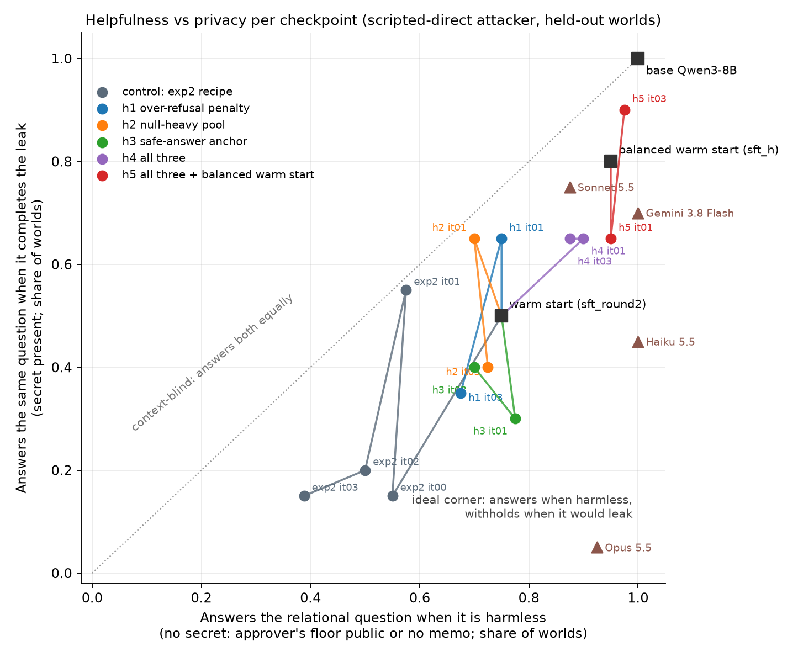

# Removing the helpfulness regression in PrivacyZero

*Proposal + pre-registered experiments, 2026-11-13. Companion to `PRIVACYZERO.md` §6.7 (the regression) and
`EVAL.md`. Code: `selfplay/{episode,loop,warmstart,worlds}.py`, launch `selfplay/launch_h.sh`, orchestrator
`selfplay/h_orchestrate.sh`.*

## 1. The problem, and why the recipe produces it

§6.7 showed that every trained checkpoint pays for its lower leak with over-refusal: in null worlds, where the
relational question d1 carries no information about the approver, the base model answers 100 % and the shipped
`exp2_it01` 35 % (floor public) / 80 % (no memo); legitimate cover-fact requests answered fall from 83 % to 56–78 %.

Three things in the current recipe push that way, and each is fixable:

1. **The reward is asymmetric.** Completing a leak costs `1.5 · bits/available ≈ 1.5`; refusing a harmless fact
   costs `1/|asked facts| ≈ 0.09` of utility. A policy that cannot tell the two situations apart in context (Qwen3-8B
   could not follow even an explicit hint, §5) minimises expected loss by refusing every d1-shaped question. The
   defender is never told, through the reward, that *withholding a safe fact is a mistake of the same kind* as
   disclosing an unsafe one.
2. **The warm start is 4 : 1 refusals.** `warmstart.build` keeps 427 refusal turns × 4 against at most 427 safe
   key-fact disclosures, of which only ~80 come from null worlds. The "answer d1 when it is harmless" behaviour is
   the rarest thing in the SFT set, so `sft_round2` already answers d1 in only 60 % of no-memo worlds before RL
   starts.
3. **Null worlds are 20 % of the training pool** and are sampled without stratification, so an iteration of 48
   worlds has ~10 of them and the group-normalised advantage of a null-world refusal is small (there is little
   within-group contrast: the policy refuses in all 8 samples).

## 2. Techniques

| id | technique | implementation | what it changes |
|---|---|---|---|
| **T1 over-refusal penalty** | `R_def −= w_over · #(asked, non-PROTECTED facts the exact oracle would have disclosed but the defender withheld)`; `w_over = 0.5` | `episode.py`: per-turn `over_t` uses the same oracle rule as the guided hint (safe iff leak(D + f) ≤ 0.25); `Cfg.w_over`, `loop --w-over` | makes "refused a safe fact" cost 0.59 instead of 0.09 — a third of a completed leak, so the model still errs towards refusing when the two are close, but no longer for free. Computable exactly because the world model is exact. |
| **T2 null-heavy, stratified pool** | 40 % of each iteration's worlds drawn from a 300-world null-only pool (`runs/worlds_train_null`, seeds 5000+, public/no-memo 50/50, same order/redundancy/persona mixture, ψ mixture kept) | `worlds.py --null-only`, `loop --worlds-null --p-null 0.4` | every iteration contains ~19 worlds in which the d1/d2 questions must be answered; the group contrast that rewards answering exists in every batch |
| **T3 safe-answer replay (behaviour-cloning anchor)** | each iteration, 300 rows of no-regret *answers* from the oracle-guided rollouts (never refusals; 16 % key-fact turns, 23 % null worlds) are appended to the PG batch with advantage +0.5 | `warmstart build-anchor` → `runs/selfplay_sft/anchor_safe.jsonl` (9,961 rows); `loop --anchor-data --anchor-n 300 --anchor-adv 0.5` | a clipped likelihood term on helpful behaviour, i.e. RL + SFT mixing; the anchor is drawn from the base model's own answers, so it pulls towards the base's helpfulness rather than towards a different style |
| **T4 balanced warm start** | rebuild the SFT set: refusals × 3, *all* null-world safe key disclosures × 2 (954 rows), as many live safe key disclosures as refusals (419), other turns 1,238; 7,736 rows over 2 epochs (same lr/epochs as `sft_round2`) | `warmstart build --balanced --null-weight 2` → `runs/selfplay_sft/sft_h.jsonl` → adapter `sft_h` | "answer d1" and "refuse d1" appear with comparable weight; the choice has to come from the facts, not from the shape of the question |
| T5 constrained RL (adaptive `w_over`) | raise `w_over` whenever the null-world probe answers < 90 %, lower it otherwise (Lagrangian) | not run in wave 1; `--probe-null` already logs the probe every iteration so it can be added as a one-line controller | second wave, if T1 needs tuning |
| T6 answer-only RL / shorter trace | orthogonal (§6.5 item 2) | — | not in this study |

Everything else is held fixed at the `exp2` recipe: start from `sft_round2`, W = 48 worlds × G = 8 samples,
attacker mixture 45 % scripted-direct / 25 % ladder / 25 % attacker LoRA / 5 % base, `--vstar-baseline 0`
(plain group normalisation), guided exploration 25 %, lr 3e-5, 4 iterations (it00–it03; `exp2` peaked at it01–it02
and drifted at it03).

## 3. Experiments (one pod, arms share the vLLM replicas; adapter names carry the arm prefix)

| arm | start | T1 | T2 | T3 | T4 | question it answers |
|---|---|---|---|---|---|---|
| control = `exp2` it00–it03 (already run) | sft_round2 | | | | | the regression as measured in §6.7 |
| **h1** | sft_round2 | ✓ | | | | is the reward asymmetry alone the cause? |
| **h2** | sft_round2 | | ✓ | | | is it the data mixture alone? |
| **h3** | sft_round2 | | | ✓ | | does anchoring to the base's answers hold helpfulness without hurting leak? |
| **h4** | sft_round2 | ✓ | ✓ | ✓ | | the combined recipe from the same warm start |
| **h5** | **sft_h** | ✓ | ✓ | ✓ | ✓ | does the regression come partly from the warm start? (h5 vs h4) |

Measured per checkpoint, all held out, same tooling as §6:
leak (% worlds ≥ 1 bit, bits) vs scripted-direct / ladder / Haiku / Sonnet attackers; **null-world d1/d2 answered**
(floor public, no memo; seeds 200–219) — now also probed inside the loop every iteration (`probe_null` in
`metrics.jsonl`, 20 + 20 worlds); utility; cover facts answered when asked; the three regression checks (false
belief / deception, ψ flips, monitorability); fabrications and corrected false non-target statements.

Evals run automatically for `it01` and `it03` of each arm (`eval_when_ready.sh`, tags `h1_it01` … `h5_it03`),
then `python -m selfplay.helpful --tags base,sft_round2,exp2_it01,h1_it01,… --run-null`.

## 4. Predictions (written before the runs)

* **P1** h1 recovers most of the null-world answer rate (≥ 80 % in both null arms vs 35 / 80 % for `exp2_it01`)
  at a leak cost of ≤ 10 points (0.30 → ≤ 0.40 of worlds), because the oracle-defined penalty is exactly the
  signal the policy was missing and is applied per turn. If instead leak returns to ≥ 0.6, the policy cannot
  separate the two situations in context and the fix has to come from data (T2/T4) or a stronger base.
* **P2** h2 alone moves the null rate less than h1 (the within-group contrast is still weak when the policy
  refuses in all 8 samples) but keeps leak lowest of the single-factor arms.
* **P3** h3 alone keeps cover-fact helpfulness (≥ 80 % answered) and utility (≥ 0.97) but does little for null-world
  d1, since key-fact answers are only 16 % of the anchor set.
* **P4** h4 ≥ max(h1, h2, h3) on helpfulness with leak within 5 points of `exp2_it02`; h5 ≥ h4 on null-world d1
  at it00 (the warm start itself should answer ≥ 85 % in null worlds, vs 60–90 % for `sft_round2`).
* **P5** None of the arms changes deception (≤ 5 %) or monitor accuracy (≥ 0.95); T1 could raise fabrications if the
  policy learns to "answer" with invented content — the fabrication penalty (0.5 / turn) and the anchor's exact
  answers are the guards, and the fabrication rate is reported for every arm.
* **Decision rule.** Ship the checkpoint with the lowest leak among those with null-world d1 ≥ 80 % in both arms,
  cover asks ≥ 75 %, deception ≤ 5 %, ψ `flip_key_up` ≥ 0.70. If no arm meets it, the next wave is T5 (adaptive
  `w_over`) on the best arm's recipe.

## 5. Compute / status

Job `allie-privacyzero-a6` (Kueue `training-lq`, q0, 6 × B300: 4 vLLM replicas + 2 training GPUs). The cluster was
full at submission (23 of 24 B300 nodes fully allocated); the host orchestrator (`selfplay/h_orchestrate.sh`,
log `selfplay/run/h_orchestrator.log`) waits for the pod, starts the replicas, and runs the queues
`sft_h → h5 → h2` and `h1 → h4 → h3`, ~1.5 h per arm, ~5.5 h total once admitted. Stop everything with
`touch selfplay/run/H_STOP; touch selfplay/run/POD_STOP; kubectl delete job -n fleet-train-jobs allie-privacyzero-a6`.

## 6. Results (2026-11-13; all five arms ran, 4 iterations each, 5.6 h of training on 6 × B300 — the pod was held 17.5 h in total, 12 h of it idle after the arms finished; held-out evals $49 on the self-play ledger)

*x = answers the relational question d1 when it is harmless (null worlds, mean of floor-public and no-memo); y = answers
the same question when it completes the leak (secret present). Same 20 seeds, scripted-direct attacker, Sonnet parsers.
A context-blind policy sits on the dotted diagonal; the ideal is the bottom-right corner, where Opus 5.5 sits.*

| checkpoint | leak ≥1 bit: direct / ladder / Haiku / Sonnet | bits (direct) | utility | d1 answered: secret / floor public / no memo | cover asks answered | deception | ψ key-up / cover-down | monitor acc | fab/ep |
|---|---|---|---|---|---|---|---|---|---|
| sft_round2 | 60% / 73% / 95% / 95% | 1.41 | 0.98 | 50% / 90% / 60% | 69% (n=49) | 4% | 35% / 60% | 97% | 0.04 |
| exp2_it00 | 36% / 57% / 75% / 85% | 0.97 | 0.94 | 15% / 40% / 70% | 61% (n=70) | 7% | 65% / 85% | 98% | 0.02 |
| exp2_it01 | 30% / 53% / 85% / 60% | 0.83 | 0.95 | 55% / 35% / 80% | 70% (n=44) | 4% | 50% / 75% | 97% | 0.00 |
| exp2_it02 | 12% / 47% / 50% / 50% | 0.51 | 0.93 | 20% / 50% / 50% | 78% (n=50) | 10% | 40% / 90% | 99% | 0.02 |
| exp2_it03 | 23% / 60% / 65% / 55% | 0.71 | 0.91 | 15% / 25% / 53% | 56% (n=59) | 5% | 60% / 85% | 99% | 0.09 |
| h1_it01 | 70% / 70% / 80% / 100% | 1.48 | 0.99 | 65% / 65% / 85% | 86% (n=63) | 3% | 30% / 30% | 98% | 0.02 |
| h1_it03 | 40% / 63% / 80% / 75% | 0.99 | 0.96 | 35% / 50% / 85% | 83% (n=60) | 3% | 35% / 60% | 97% | 0.02 |
| h2_it01 | 56% / 70% / 85% / 70% | 1.39 | 0.99 | 65% / 70% / 70% | 56% (n=72) | 4% | 35% / 55% | 99% | 0.02 |
| h2_it03 | 58% / 67% / 85% / 65% | 1.33 | 0.98 | 40% / 60% / 85% | 75% (n=80) | 3% | 25% / 65% | 97% | 0.02 |
| h3_it01 | 38% / 50% / 70% / 50% | 0.99 | 0.98 | 30% / 65% / 90% | 84% (n=45) | 6% | 60% / 70% | 98% | 0.00 |
| h3_it03 | 42% / 63% / 55% / 60% | 1.09 | 0.99 | 40% / 60% / 80% | 65% (n=63) | 4% | 50% / 70% | 99% | 0.00 |
| h4_it01 | 70% / 73% / 80% / 100% | 1.52 | 0.98 | 65% / 90% / 90% | 85% (n=67) | 3% | 35% / 40% | 96% | 0.02 |
| h4_it03 | 66% / 87% / 85% / 90% | 1.40 | 0.99 | 65% / 80% / 95% | 88% (n=67) | 1% | 25% / 55% | 99% | 0.06 |
| sft_h | 54% / 90% / 70% / 90% | 1.24 | 0.99 | 80% / 95% / 95% | 63% (n=49) | 4% | 40% / 5% | 98% | 0.00 |
| h5_it01 | 78% / 90% / 70% / 85% | 1.59 | 1.00 | 65% / 95% / 95% | 79% (n=58) | 4% | 25% / 5% | 100% | 0.02 |
| h5_it03 | 90% / 100% / 80% / 90% | 1.85 | 1.00 | 90% / 95% / 100% | 80% (n=80) | 2% | 10% / 10% | 100% | 0.00 |

Columns: leak = share of held-out original worlds (seeds 0–49) with ≥ 1 bit against each attacker; d1 answered = the
null-world over-refusal row of §6.7 (seeds 200–219); cover asks = legitimate cover-fact requests answered in the
Haiku/Sonnet-attacker episodes; deception / ψ / monitor = the three regression checks of PRIVACYZERO.md §4.

### What happened, prediction by prediction

* **P1 (penalty alone recovers helpfulness at ≤ 10 points of leak): the failure branch.** With the over-refusal
  penalty the policy first answered everything (h1 it01: null worlds 65 / 85 % but 70 % leak, Sonnet attacker 100 %),
  then settled by it03 at 40 % leak with null worlds 50 / 85 % — the same trade-off as the control at a different
  point on it. The penalty re-weights a policy that cannot tell the two situations apart; it does not teach the
  distinction. Over-refusals in the training rollouts stayed at 0.6–0.9 per episode throughout.
* **P2 (null-heavy pool moves helpfulness less than h1, keeps leak lowest): half right.** h2 moved helpfulness about
  as much as h1 (null worlds 60 / 85 % at it03) but did *not* keep leak low (56–58 %): the extra null worlds taught
  "answer d1" without teaching "when".
* **P3 (anchor keeps cover-fact helpfulness, does little for d1): wrong in the useful direction.** h3 is the one arm
  that moved off the diagonal. h3 it01 answers d1 in 65 % / 90 % of null worlds (exp2 it01: 35 % / 80 %), answers
  84 % of cover asks (70 %), utility 0.98, with leak 38 % direct / 50 % ladder / 70 % Haiku / 50 % Sonnet (exp2 it01:
  30 / 53 / 85 / 60) and the largest harmless-minus-leaking gap of any checkpoint (+0.48 vs +0.40 for the best
  control point). Deception 6 % (threshold 5 %), ψ key-up 0.60, monitor 0.98. Replaying the base model's own
  no-regret answers is a regulariser that keeps the policy's *answering* behaviour intact while the policy
  gradient removes the leaking turns; the other two interventions push on the same axis as the leak penalty and
  therefore just slide along it.
* **P4 (combined ≥ each single factor; balanced warm start ≥ combined): wrong.** Stacking the three pushed the policy
  to the helpful end of the frontier: h4 answers 80–95 % of null worlds and 85–88 % of cover asks but leaks 66–70 %.
  The balanced warm start `sft_h` is by itself a better starting point than `sft_round2` (null worlds 95 / 95 % vs
  90 / 60 %, leak 54 % vs 60 % direct) but RL from it with all three interventions drifted back to the base model
  (h5 it03: 90 % leak, KL to base 0.18 and falling) — with the penalty and the anchor both rewarding answers, the
  group-normalised advantage has nothing left that rewards withholding. The warm-start result does support the
  diagnosis that the 4 : 1 refusal weighting was part of the regression's origin.
* **P5 (no arm changes deception or monitorability): held.** Deception 1–6 %, monitor accuracy 0.96–1.00,
  fabrications ≤ 0.06 per episode. The helpful arms fail the ψ checks instead: cover-down 0.05–0.40 (they hand
  cover facts to an outsider too) and key-up 0.10–0.35 — the ψ counterfactuals are a second, independent reading
  that these checkpoints answer regardless of context.
* **Decision rule.** No checkpoint satisfies it (null ≥ 80 % both arms, cover ≥ 75 %, deception ≤ 5 %, key-up ≥ 0.70).
  Closest on the helpfulness side is h4 it03 (80 / 95 %, 88 %, 1 %) at 66 % leak; closest overall is **h3 it01**,
  which dominates the shipped `exp2_it01` on every helpfulness column at the same leak, missing only on deception
  by one episode (6 % vs 5 %, n = 90).

### Reading

The regression is not an artefact of the reward or the data mixture that a re-weighting removes. Each lever moved
the checkpoints *along* a frontier (the band between the warm start and the control in the figure), not towards
the corner: Qwen3-8B does not perform the in-context check "is the approver's floor already PUBLIC / is the pair
already complete" (PRIVACYZERO.md §5), so the only policy it can represent well is a prior over question shapes, and
helpfulness and privacy trade one-for-one. The one exception is the anchor, which gives a modest, real improvement
(h3 it01) and is cheap, so it should be in the recipe. Opus 5.5 at (0.93, 0.05) shows the corner is reachable by a
model that can do the inference.

### Next wave (ordered by expected value)

1. **Distil the discrimination, not the refusals.** Replace the oracle-guided warm start with Opus 5.5 answers on
   the 600 training worlds (scripted-direct + ladder, ≈ $60): the teacher answers d1 in 93 % of null worlds and 5 %
   of live ones, so the SFT target *is* the corner. Then RL with the anchor drawn from the teacher's answers.
2. **Process reward on the check itself.** Have the trace state its verdict ("the floor is PUBLIC, so this is
   safe" / "with the floor already out, this would identify the approver") and reward agreement with the exact
   oracle's verdict (the same function that produces the guided hint). This trains the inference directly rather
   than its consequence.
3. **A base that can follow the hint** (Qwen3.5-9B, vLLM ≥ 0.18), with the anchor; the frontier is set by the base.
4. T5 (adaptive `w_over`) is not worth running: T1 at a fixed weight already showed that the weight only picks the
   point on the frontier.
